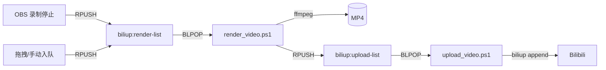
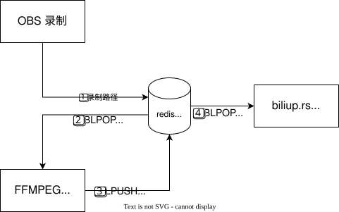

# 完美的 bilibili 录制方案

## why

一条龙服务，还可以多机操作，爽爆！

## what

依赖如下组件：

- redis
- ffmpeg
- obs
- smb
- [biliup-rs](https://github.com/biliup/biliup-rs)

数据流：

1. OBS 录制停止后，脚本把录制文件推入 `biliup:render-list`。
2. Windows 渲染 worker 取任务，用 ffmpeg 编码，把结果推入 `biliup:upload-list`。
3. Windows 上传 worker 取任务，用 `biliup append` 上传到 Bilibili。





## 目录结构

```text
perfect_bili_record_upload
├─ README.md
├─ CHANGELOG.md
├─ docs/
│  ├─ architecture.md          # 架构、队列、部署
│  ├─ ffmpeg-notes.md          # 历史 ffmpeg 命令记录
│  └─ render-video-module.md   # RenderVideo 模块设计
├─ obs_scripts/                # OBS Python 脚本
│  ├─ README.md
│  ├─ handle_stop.py           # 录制停止 -> 推入渲染队列
│  └─ load_config.py
├─ win_scripts/                # Windows 端脚本
│  ├─ RenderVideo/             # 纯编码/拆分模块
│  ├─ PerfectBili.Common/      # 日志、通知、Redis 公共模块
│  ├─ append_render_redis.bat  # 拖拽入队入口
│  ├─ enqueue_render.ps1       # 入队实现
│  ├─ render_video.ps1         # 渲染 worker
│  ├─ upload_video.ps1         # 上传 worker
│  ├─ render.config.example.psd1
│  ├─ upload.config.example.psd1
│  └─ README.md
└─ docker/
   └─ uploader/
```

## 快速开始

### 1. 安装依赖

- 安装 Redis、ffmpeg、OBS、biliup。
- 确保 `ffmpeg`、`ffprobe`、`redis-cli`、`biliup` 在 PATH 中。
- 确认 ffmpeg 带 `h264_nvenc`（或改用 `libx264`）。

### 2. 准备配置

```powershell
cd win_scripts
Copy-Item .\render.config.example.psd1 .\render.config.psd1
Copy-Item .\upload.config.example.psd1 .\upload.config.psd1
# 编辑两个配置文件
```

两个真实配置文件都被 `.gitignore` 忽略，不会提交到仓库。

### 3. 检查环境

```powershell
.\render_video.ps1 -ValidateOnly
.\upload_video.ps1 -ValidateOnly
```

### 4. 启动 worker

```powershell
# 渲染端：常驻等待新任务
.\render_video.ps1 -waitForNewTask

# 上传端：另开一个窗口
.\upload_video.ps1
```

### 5. 加入任务

- 让 OBS 脚本 `obs_scripts/handle_stop.py` 在录制停止时自动入队。
- 或者把视频拖到 `win_scripts/append_render_redis.bat`。
- 或者手动执行：

  ```powershell
  .\win_scripts\enqueue_render.ps1 'D:\record\a.mkv'
  ```

## 主要组件

| 组件 | 说明 |
| --- | --- |
| `obs_scripts/handle_stop.py` | OBS 停止录制时把最新文件推入 `biliup:render-list` |
| `win_scripts/render_video.ps1` | 取渲染任务，调用 `Invoke-VideoRender` 编码 |
| `win_scripts/upload_video.ps1` | 取上传任务，调用 `biliup append` |
| `win_scripts/enqueue_render.ps1` | 手动/拖拽入队 |
| `win_scripts/RenderVideo/` | 编码、快速拆分、媒体信息、环境检查 |
| `win_scripts/PerfectBili.Common/` | 日志、微信通知、Redis CLI 封装 |

## RenderVideo 模块

模块可单独使用，不依赖 Redis / 微信 / 上传：

```powershell
Import-Module .\win_scripts\RenderVideo\RenderVideo.psd1

# 编码
Invoke-VideoRender -InputPath .\a.mkv -OutputPath .\out\a.mp4 -FastStart

# 按 10:00 / 20:00 快速拆分（-c copy）
Split-Video -InputPath .\a.mkv -TimePoint 10:00, 20:00

# 检查 ffmpeg / NVENC
Test-RenderEnvironment | Format-List
```

默认显示 ffmpeg 风格进度；`-NoProgress` 关闭。
完整参数见 [`win_scripts/RenderVideo/README.md`](./win_scripts/RenderVideo/README.md)。

## Redis 键

| 键 | 用途 |
| --- | --- |
| `biliup:render-list` | 待渲染任务 |
| `biliup:processing:rendering` | 当前渲染任务 |
| `biliup:upload-list` | 待上传任务 |
| `biliup:processing:uploading` | 当前上传任务 |
| `biliup:render-failed` | 渲染失败任务 |
| `biliup:upload-failed` | 上传失败任务 |
| `obs:record` / `obs:status` | OBS 状态 |

## 注意事项

1. PowerShell 脚本（`.ps1` / `.psm1` / `.psd1`）统一使用 **UTF-8 with BOM**，同时兼容 Windows PowerShell 5.1 和 PowerShell 7。
2. `.bat` 文件保持 ASCII / CRLF，避免中文 Windows 下的编码问题。
3. 真实配置 `render.config.psd1` / `upload.config.psd1` 不要提交；仓库只保留 `*.example.psd1`。
4. 执行 PowerShell 脚本需要调整策略，例如：
   `Set-ExecutionPolicy -Scope CurrentUser RemoteSigned`
5. `Split-Video` 使用 `-c copy`，只能按关键帧切；需要精确切点请重新编码。
6. 渲染/上传失败的任务会进入 `biliup:render-failed` / `biliup:upload-failed`，不会自动重试。

## 文档

- [架构与数据流](./docs/architecture.md)
- [RenderVideo 模块设计](./docs/render-video-module.md)
- [FFmpeg 历史命令](./docs/ffmpeg-notes.md)

## 参考

1. [tporadowski | redis](https://github.com/tporadowski/redis)
2. [biliup | biliup-rs](https://github.com/biliup/biliup-rs)
3. [Niek | OBS-web](https://github.com/Niek/obs-web)
4. [Python Scripting - Pulling audio source information](https://obsproject.com/forum/threads/python-scripting-pulling-audio-source-information.142254/)
