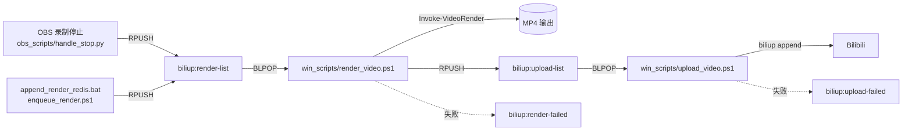

# 架构与数据流

## 总览

## 组件

| 组件 | 作用 |
| --- | --- |
| `obs_scripts/handle_stop.py` | OBS 录制停止时把最新录制文件推入 `biliup:render-list` |
| `win_scripts/enqueue_render.ps1` | 手动/拖拽把文件推入 `biliup:render-list` |
| `win_scripts/append_render_redis.bat` | 拖拽入口，调用 `enqueue_render.ps1` |
| `win_scripts/render_video.ps1` | 渲染 worker，调用 `RenderVideo` 模块编码，成功后推入 `biliup:upload-list` |
| `win_scripts/upload_video.ps1` | 上传 worker，调用 `biliup append` 上传 |
| `win_scripts/RenderVideo/` | 纯编码/拆分模块，不依赖 Redis、通知或上传 |
| `win_scripts/PerfectBili.Common/` | 公共日志、微信通知、Redis CLI 封装 |

## 队列与状态键

| 键 | 类型 | 说明 |
| --- | --- | --- |
| `biliup:render-list` | List | 待渲染任务，元素为 JSON：`{"filename":"...","bvid":"BV..."}` |
| `biliup:processing:rendering` | String | 当前正在渲染的任务 |
| `biliup:upload-list` | List | 待上传任务，元素为 JSON：`{"filename":"...mp4","bvid":"BV..."}` |
| `biliup:processing:uploading` | String | 当前正在上传的任务 |
| `biliup:render-failed` | List | 渲染失败的任务，保留原始 JSON |
| `biliup:upload-failed` | List | 上传失败的任务，保留原始 JSON |
| `obs:record` | String | OBS 录制状态（`stop` / `paused`） |
| `obs:status` | String | OBS 脚本加载状态 |

失败列表是新增的，便于排查和手动重试；不会自动重试，避免坏任务无限循环。

## 渲染流程

1. `render_video.ps1` 从 `biliup:render-list` `BLPOP` 取任务。
2. 写入 `biliup:processing:rendering`。
3. 根据 `render.config.psd1` 的 `InputPath` 解析输入文件，调用 `Invoke-VideoRender`。
4. 成功后：
   - 通知微信
   - 删除 `biliup:processing:rendering`
   - 推入 `biliup:upload-list`（除非 `-noUpload`）
5. 失败时：
   - 通知微信
   - 删除 `biliup:processing:rendering`
   - 推入 `biliup:render-failed`

`-waitForNewTask` 使用 `BLPOP ... 0` 常驻等待；不加时使用 5 秒超时，队列空闲后退出，可配合 `-shutdown`。

## 上传流程

1. `upload_video.ps1` 从 `biliup:upload-list` `BLPOP` 取任务。
2. 写入 `biliup:processing:uploading`。
3. 根据 `upload.config.psd1` 的 `OutputPath` 解析文件，执行：
   `biliup append <BiliupArgs> --vid <bvid> <file>`
4. 成功后通知微信并清理状态。
5. 失败时通知微信、清理状态，并推入 `biliup:upload-failed`。

## 配置

- `win_scripts/render.config.psd1`：Redis、输入/输出目录、通知、编码参数。
- `win_scripts/upload.config.psd1`：Redis、输出目录、通知、biliup 参数。
- 两个真实配置文件都被 `.gitignore` 忽略；仓库只提交 `*.example.psd1`。
- 通知地址是完整 URL，支持 `basic` / `bearer` / `none`。
- 通知 JSON 统一为 `{ "target": "...", "content": "..." }`；旧上传脚本的 `para` 格式已不再使用。

## 编码与拆分

- 编码由 `RenderVideo` 模块完成，默认 `h264_nvenc`、`-cq 19`、20M 目标码率、30M 上限。
- 进度使用 `ffmpeg -progress pipe:1` 解析后显示，默认开启，`-NoProgress` 关闭。
- 快速拆分使用 `Split-Video`，内部是一次 `-f segment -segment_times ... -c copy` 调用。
- `-c copy` 只能在关键帧处切，实际切点可能有偏差；同一 GOP 内的多个时间点可能被合并，函数会报错并保留已生成文件。

## 部署建议

- 代码放在本仓库；实际配置放在部署机的 `win_scripts/*.config.psd1`。
- 渲染 worker 和上传 worker 可以分别运行在不同机器，只要连同一个 Redis。
- 建议用计划任务/开机启动让 `render_video.ps1 -waitForNewTask` 和 `upload_video.ps1` 常驻。
- 日志目录、输出目录需要提前规划磁盘空间。
